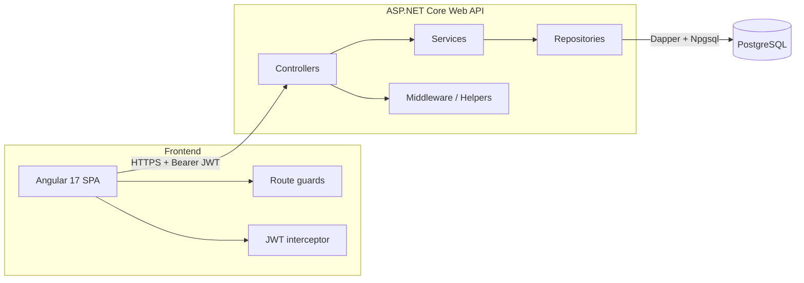
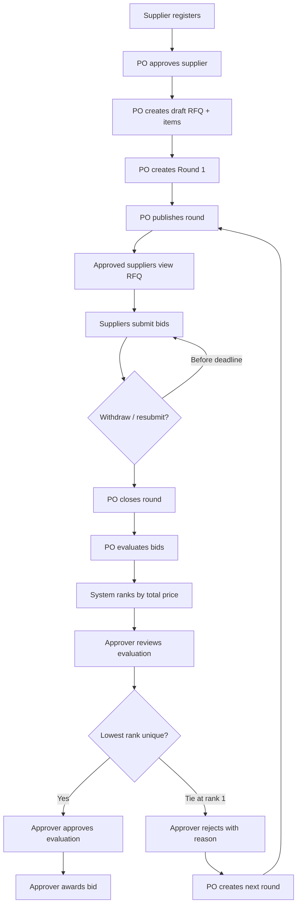
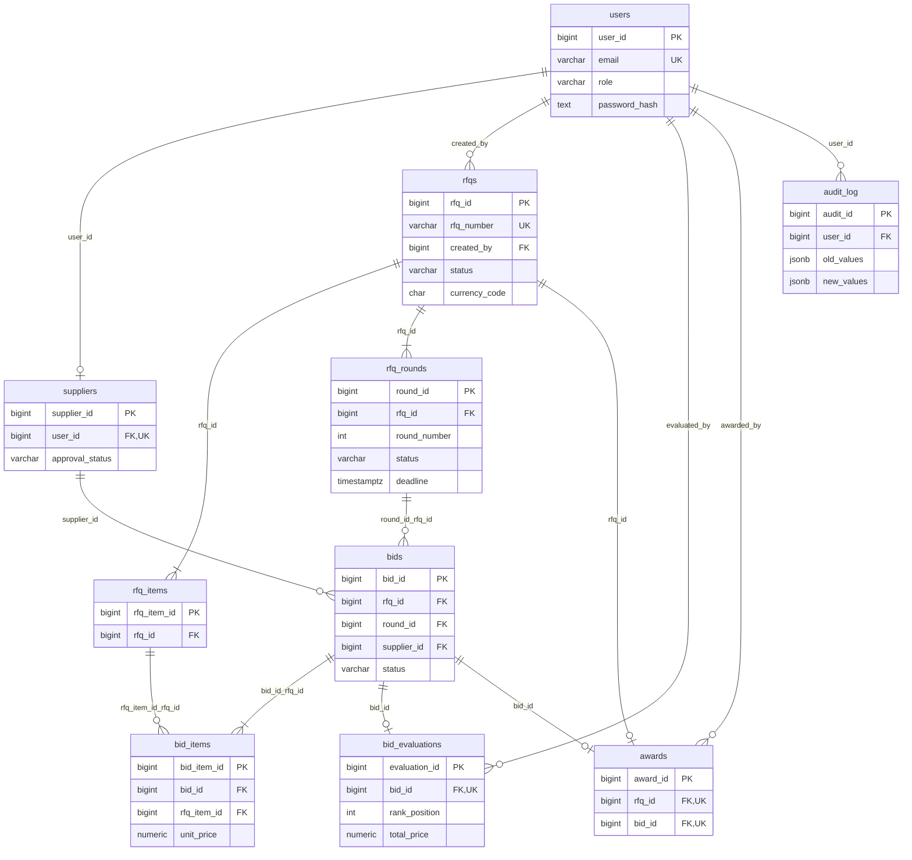

# ABB Supplier RFQ and Bidding Portal

## Table of contents

1. [Project introduction](#project-introduction)
2. [Technology stack](#technology-stack)
3. [Application architecture](#application-architecture)
4. [User roles and permissions](#user-roles-and-permissions)
5. [Complete business workflow](#complete-business-workflow)
6. [Business rules](#business-rules)
7. [Database design](#database-design)
8. [Project structure](#project-structure)
9. [Prerequisites](#prerequisites)
10. [Database setup](#database-setup)
11. [Backend setup](#backend-setup)
12. [Angular setup](#angular-setup)
13. [Configuration](#configuration)
14. [API documentation](#api-documentation)
15. [Automated testing](#automated-testing)
16. [Demo credentials](#demo-credentials-local-development-only)
17. [Known limitations](#known-limitations)
18. [AI assistance](#ai-assistance)

---

## Project introduction

### Project name

**ABB Supplier RFQ and Bidding Portal**

### Problem statement

Procurement teams need a controlled way to publish requests for quotation (RFQs), collect structured supplier bids against mandatory line items, evaluate offers fairly after deadlines, resolve tied lowest prices, and award contracts—with a full audit trail and strict confidentiality of bid amounts before evaluation.

### Project objective

Deliver an end-to-end prototype where:

- **Suppliers** register, get approved, and bid on published rounds.
- **Procurement Officers** manage RFQs, rounds, supplier approval, evaluation, and audit review.
- **Approvers** confirm evaluation outcomes (including tie rejection) and issue awards.

### Main features

- JWT-authenticated REST API (ASP.NET Core 9) with role-based access control.
- PostgreSQL schema with Dapper data access, transactions, and ranking function `get_ranked_bids`.
- Angular 17 SPA with role-based routes, guards, and JWT HTTP interceptor.
- Bid evaluation with `RANK()` tie handling and approver decision workflow.
- Award management with mandatory award comment.
- Read-only audit log APIs for procurement and approver roles.
- xUnit automated tests (14 cases) for deadline, duplicate bid, validation, and authorization rules.

---

## Technology stack

| Layer | Technology | Version / notes |
|-------|------------|-----------------|
| API runtime | ASP.NET Core Web API | **.NET 9** (`net9.0`) |
| Language | C# | Latest for .NET 9 |
| Frontend | Angular | **17.3.x** (standalone components) |
| Frontend language | TypeScript | Via Angular toolchain |
| Database | PostgreSQL | Schema in `database/schema.sql` |
| Data access | Dapper + Npgsql | Dapper 2.1.x, Npgsql 9.0.x |
| Auth | JWT Bearer | `Microsoft.AspNetCore.Authentication.JwtBearer` 9.0 |
| API docs | Swagger (Swashbuckle) | 7.2.x |
| Password hashing | BCrypt | `BCrypt.Net-Next` 4.0.3 |
| Unit tests | xUnit | 2.9.x, Moq, `Microsoft.AspNetCore.Mvc.Testing` 9.0 |

---

## Application architecture

The system follows a classic layered design. The Angular SPA calls JSON REST endpoints; the API enforces authentication and business rules before persisting data in PostgreSQL.



### Layer responsibilities

| Layer | Responsibility |
|-------|----------------|
| **Angular (presentation)** | Login, registration, role dashboards, RFQ/bid/evaluation/award UIs, client validation, loading and error states. |
| **Controllers** | HTTP routing, authorization attributes, model binding, status codes, Swagger metadata. |
| **Services** | Business validation, orchestration, mapping entities to DTOs, throwing `ApiException` with correct HTTP semantics. |
| **Repositories** | Parameterized SQL, transactions, calling `get_ranked_bids`, audit inserts in the same transaction where required. |
| **PostgreSQL** | Relational integrity, partial unique indexes, ranking function, persistent audit and evaluation results. |

**Dependency injection:** Repositories and services are registered as scoped services in `Program.cs`; `DapperContext` provides connections. JWT settings bind from configuration via `IOptions<JwtSettings>`.

---

## User roles and permissions

Verified against API `[Authorize]` attributes on controllers (Suppliers cannot call procurement endpoints; suppliers have no access to evaluation or audit APIs).

### Supplier

| Capability | API / UI |
|------------|----------|
| Register and log in | `POST /api/auth/register`, `POST /api/auth/login`; `/register`, `/login` |
| Manage supplier profile | `GET/PUT /api/suppliers/me`; `/supplier/profile` |
| View open RFQs (approved only) | `GET /api/supplier/rfqs`, `GET /api/supplier/rfqs/{rfqId}`; `/supplier/rfqs` |
| Submit bid | `POST /api/rfqs/{rfqId}/rounds/{roundId}/bids` |
| Withdraw bid | `PATCH /api/bids/{bidId}/withdraw` |
| View own bidding history | `GET /api/bids/me`, `GET /api/bids/{bidId}`; `/supplier/my-bids` |

Suppliers **cannot** access evaluation results, other suppliers’ bids, audit logs, or RFQ management APIs (**403**).

### Procurement Officer

| Capability | API / UI |
|------------|----------|
| Create and edit draft RFQs | `POST/PUT /api/rfqs` |
| View RFQs and rounds | `GET /api/rfqs`, `GET /api/rfqs/{id}`, `GET /api/rfqs/{id}/rounds` |
| Create, publish, close rounds | `POST .../rounds`, `PATCH .../publish`, `PATCH .../close` |
| Review and approve/suspend suppliers | `GET /api/suppliers`, `PATCH /api/suppliers/{id}/status` |
| Evaluate closed rounds | `POST .../evaluate` |
| View evaluation results (after evaluate) | `GET .../evaluation`, `GET .../evaluation/{bidId}` |
| View awards | `GET /api/rfqs/{rfqId}/award`, `GET /api/awards` |
| Audit history | `GET /api/audit-logs` and related; `/audit-logs` |

Procurement Officers **cannot** submit bids, submit approver decisions, or create awards. They **do not** have an API to read raw supplier bids before evaluation—only post-evaluation ranking data.

### Approver

| Capability | API / UI |
|------------|----------|
| View RFQs (read-only) | `GET /api/rfqs*` (no create/update) |
| View suppliers (read-only) | `GET /api/suppliers*` (no status PATCH) |
| View evaluation results | `GET .../evaluation`, `GET .../evaluation/{bidId}` |
| Approve or reject evaluation | `POST .../evaluation/decision` |
| Create award | `POST /api/rfqs/{rfqId}/rounds/{roundId}/award` |
| List awards | `GET /api/awards`, `GET /api/rfqs/{rfqId}/award` |
| Manage user active flag | `GET /api/users`, `PATCH /api/users/{id}/active` |
| Audit history | Same audit endpoints as PO; `/audit-logs` |

**Note:** In the Angular app, `/approver/rfqs` is a **placeholder** screen—not a full RFQ browser (see [Known limitations](#known-limitations)).

---

## Complete business workflow



### Step-by-step lifecycle

1. Supplier self-registers (`Pending` approval).
2. Procurement Officer approves the supplier (`Approved`).
3. PO creates an RFQ in **Draft** with one or more line items.
4. All RFQ items are mandatory for bidders (no optional lines in schema).
5. PO creates **Round 1** with a future **deadline**.
6. PO **publishes** the round (RFQ becomes **Published**).
7. Approved suppliers list and open published RFQs.
8. Suppliers submit bids (all lines, positive unit prices).
9. Suppliers may **withdraw** and **submit a new bid** in the same round before the deadline; withdrawn rows remain in history.
10. PO **closes** the round (manual step; deadline also blocks late bids).
11. PO runs **evaluate** on a **Closed** round.
12. System computes `SUM(quantity × unit_price)` and persists ranks via `get_ranked_bids` / `bid_evaluations`.
13. Approver reviews rankings and tie flag (`isLowestRankTied`).
14. Approver **approves** if exactly one lowest rank, or **rejects** with mandatory reason on a tie.
15. After **rejection**, PO may create a **subsequent round** (RFQ must be **Evaluated** per round rules).
16. After **approval**, Approver **awards** the chosen rank-1 bid; RFQ becomes **Awarded**.

### Evaluation approval vs final award

| Step | Actor | Meaning |
|------|-------|---------|
| **Evaluation** | Procurement Officer | Computes ranks and stores `bid_evaluations`; RFQ/round → **Evaluated**. |
| **Evaluation decision (Approved)** | Approver | Confirms a **unique** lowest bid is acceptable; recorded in `audit_log`; enables award. |
| **Evaluation decision (Rejected)** | Approver | Tied lowest rank; reason required; **no award**; triggers new round workflow. |
| **Award** | Approver | Creates the single `awards` row for the RFQ, with mandatory `awardComment`; RFQ → **Awarded**. |

Award does **not** auto-select a winner—the Approver sends explicit `bidId`. Rank 2 is never auto-awarded on a tie.

---

## Business rules

| Rule | Implementation |
|------|----------------|
| Only **Approved** suppliers can bid | `BidRepository.SubmitAsync` checks `suppliers.approval_status` inside transaction (**403** if not approved). |
| All RFQ items mandatory | `BidService.ValidateAndNormalizeItems` requires every `rfq_item_id`. |
| Unit prices **> 0** | Service validation + `chk_bid_item_price` in DB. |
| No bids after deadline | `BidDeadlineRules.IsBiddingOpen` — strict `deadline > UtcNow` (equal instant closed). |
| One **active** bid per supplier per round | Partial unique index `ux_active_supplier_rfq_round`; duplicate → **409**. |
| Withdrawn bids kept | `status = 'Withdrawn'` + `withdrawn_at`; not deleted. |
| Bid total | `SUM(rfq_items.quantity * bid_items.unit_price)` in `get_ranked_bids`. |
| Equal totals, equal rank | PostgreSQL `RANK() OVER (ORDER BY total_price ASC)`. |
| No auto-award on tie | Approver must **reject**; new round required. |
| Award needs approved evaluation + unique rank 1 | `AwardRepository` validates audit `EvaluationApproved` and recomputed rank. |
| Audit on important actions | `AuditLogHelper.InsertAsync` in same transaction as bid/RFQ/supplier/award writes. |

---

## Database design

### Entity-relationship diagram



### Notable constraints and indexes

- **`ux_users_email`** — case-insensitive unique email.
- **`ux_one_published_round_per_rfq`** — at most one `Published` round per RFQ.
- **`ux_active_supplier_rfq_round`** — partial unique on `(rfq_id, round_id, supplier_id)` where `status <> 'Withdrawn'`.
- **Composite FKs** — e.g. `bids(round_id, rfq_id)` → `rfq_rounds`; `bid_items(bid_id, rfq_id)` → `bids`; prevents cross-RFQ data corruption.
- **`get_ranked_bids(p_rfq_id, p_round_id)`** — returns `bid_id`, `supplier_id`, `total_price`, `rank_position` for `Submitted` bids only.

See [database/README.md](database/README.md) and [database/schema.sql](database/schema.sql) for full DDL.

---

## Project structure

```
ABB/
├── README.md
├── DESIGN_DECISIONS.md
├── PROJECT_WALKTHROUGH.md
├── database/
│   ├── schema.sql
│   ├── verify.sql
│   └── README.md
├── RFQAPI/
│   ├── RFQAPI.slnx
│   ├── RFQAPI/
│   │   ├── Controllers/
│   │   ├── DAL/
│   │   ├── Helpers/
│   │   ├── Middleware/
│   │   ├── Models/
│   │   ├── Properties/
│   │   ├── Repositories/
│   │   │   ├── Implementations/
│   │   │   └── Interfaces/
│   │   ├── Services/
│   │   │   ├── Implementations/
│   │   │   └── Interfaces/
│   │   ├── Program.cs
│   │   └── RFQAPI.csproj
│   └── RFQAPI.Tests/
│       ├── BidDeadlineRulesTests.cs
│       ├── BidServiceValidationAndDuplicateTests.cs
│       ├── BidVisibilityAndAuthorizationTests.cs
│       └── RFQAPI.Tests.csproj
├── RFQAPPLICATION/
│   └── abb-rfq-bid-portal/
│       └── src/app/
│           ├── core/          # guards, interceptors, services, models
│           ├── features/      # auth, dashboards, supplier, procurement, approver, audit-logs
│           └── shared/        # layout, navigation, shared components
└── tools/                   # PowerShell workflow helpers (optional)
```

---

## Prerequisites

| Tool | Purpose |
|------|---------|
| [.NET 9 SDK](https://dotnet.microsoft.com/download) | Build and run API, run xUnit tests |
| [Node.js](https://nodejs.org/) 18+ and npm | Angular dependencies |
| [Angular CLI](https://angular.io/) 17.x | Optional; `npm start` uses local CLI |
| PostgreSQL 14+ (typical) | Application database |
| Git | Source control |

---

## Database setup

1. Install PostgreSQL and create an empty database (e.g. `abb_hackathon`).
2. On a **fresh** database only, apply the schema:

   ```bash
   psql -h <host> -U <user> -d abb_hackathon -f database/schema.sql
   ```

3. Verify:

   ```bash
   psql -h <host> -U <user> -d abb_hackathon -f database/verify.sql
   ```

   Expect **10 tables** and the `get_ranked_bids` function (see [database/README.md](database/README.md)).

### Warning: existing databases

`schema.sql` is intended for **initial** provisioning. **Do not** blindly re-run it on a database that already contains RFQs, bids, or awards—it can fail on existing objects or destroy data if you drop objects manually.

### Procurement Officer and Approver users

The public API only **registers Suppliers**. Internal **ProcurementOfficer** and **Approver** accounts must be inserted or updated directly in the `users` table (BCrypt password hash). The repository does not ship a SQL seed file; development environments typically already contain users such as those in [Demo credentials](#demo-credentials-local-development-only).

---

## Backend setup

**Working directory:** `RFQAPI/RFQAPI`

```bash
cd RFQAPI/RFQAPI
dotnet restore
dotnet user-secrets set "Jwt:Key" "<your-local-signing-key-at-least-32-chars>"
dotnet build
dotnet run --launch-profile http
```

| Item | Value |
|------|--------|
| HTTP URL | `http://localhost:5013` |
| Swagger | `http://localhost:5013/swagger` (Development) |
| HTTPS profile | `https://localhost:7061` (optional `launch-profile https`) |

Solution build (API + tests):

```bash
cd RFQAPI
dotnet build RFQAPI.slnx
```

---

## Angular setup

**Working directory:** `RFQAPPLICATION/abb-rfq-bid-portal`

```bash
cd RFQAPPLICATION/abb-rfq-bid-portal
npm install
npm run build
npm start
```

| Item | Value |
|------|--------|
| Dev server | `http://localhost:4200` |
| API CORS | Allows `http://localhost:4200` |

Configure the API base URL in the Angular environment/settings if your API host differs from `http://localhost:5013`.

---

## Configuration

| Key | Required | Description |
|-----|----------|-------------|
| `ConnectionStrings:RfqDb` | Yes | PostgreSQL connection (host, port, database, username, password). |
| `Jwt:Key` | Yes | Symmetric signing key, **minimum 32 characters** (User Secrets or environment variable). |
| `Jwt:Issuer` | Yes | Default `RFQAPI` in `appsettings.json`. |
| `Jwt:Audience` | Yes | Default `RFQAPI`. |
| `Jwt:ExpirationMinutes` | Yes | Token lifetime (default 60). |

**Never commit real passwords or JWT keys.** Use:

```bash
cd RFQAPI/RFQAPI
dotnet user-secrets set "ConnectionStrings:RfqDb" "Host=...;Port=5432;Database=...;Username=...;Password=..."
dotnet user-secrets set "Jwt:Key" "YourLocalDevelopmentKey_Minimum32Characters"
```

---

## API documentation

Base path: `/api`. All secured endpoints expect `Authorization: Bearer <token>` unless noted.

### Authentication and users

| Method | Route | Role | Description |
|--------|-------|------|-------------|
| POST | `/api/auth/register` | Anonymous | Supplier registration (user + supplier, `Pending`). |
| POST | `/api/auth/login` | Anonymous | Returns JWT and user profile. |
| GET | `/api/users/me` | Any authenticated | Current user. |
| GET | `/api/users` | Approver | Paginated users. |
| PATCH | `/api/users/{id}/active` | Approver | Activate/deactivate user. |

### Supplier management

| Method | Route | Role | Description |
|--------|-------|------|-------------|
| GET | `/api/suppliers/me` | Supplier | Own supplier profile. |
| PUT | `/api/suppliers/me` | Supplier | Update company/contact fields. |
| GET | `/api/suppliers` | PO, Approver | Paginated supplier list. |
| GET | `/api/suppliers/{supplierId}` | PO, Approver | Supplier detail with user info. |
| PATCH | `/api/suppliers/{supplierId}/status` | PO | `Approved` or `Suspended`. |

### RFQ management

| Method | Route | Role | Description |
|--------|-------|------|-------------|
| POST | `/api/rfqs` | PO | Create draft RFQ + items. |
| PUT | `/api/rfqs/{rfqId}` | PO | Update draft RFQ. |
| GET | `/api/rfqs` | PO, Approver | Paginated RFQ list. |
| GET | `/api/rfqs/{rfqId}` | PO, Approver | RFQ detail with items. |

### RFQ rounds

| Method | Route | Role | Description |
|--------|-------|------|-------------|
| POST | `/api/rfqs/{rfqId}/rounds` | PO | Create round with deadline. |
| PATCH | `/api/rfqs/{rfqId}/rounds/{roundId}/publish` | PO | Publish draft round. |
| PATCH | `/api/rfqs/{rfqId}/rounds/{roundId}/close` | PO | Close published round. |
| GET | `/api/rfqs/{rfqId}/rounds` | PO, Approver | List rounds. |
| GET | `/api/rfqs/{rfqId}/rounds/{roundId}` | PO, Approver | Round detail. |

### Supplier RFQ listing

| Method | Route | Role | Description |
|--------|-------|------|-------------|
| GET | `/api/supplier/rfqs` | Supplier | Published RFQs available to bid. |
| GET | `/api/supplier/rfqs/{rfqId}` | Supplier | RFQ detail + eligibility for active round. |

### Bid management

| Method | Route | Role | Description |
|--------|-------|------|-------------|
| POST | `/api/rfqs/{rfqId}/rounds/{roundId}/bids` | Supplier | Submit bid. |
| GET | `/api/bids/me` | Supplier | Paginated own bids. |
| GET | `/api/bids/{bidId}` | Supplier | Own bid detail (scoped by supplier). |
| PATCH | `/api/bids/{bidId}/withdraw` | Supplier | Withdraw before deadline. |

### Evaluation and ranking

| Method | Route | Role | Description |
|--------|-------|------|-------------|
| POST | `/api/rfqs/{rfqId}/rounds/{roundId}/evaluate` | PO | Evaluate closed round. |
| GET | `/api/rfqs/{rfqId}/rounds/{roundId}/evaluation` | PO, Approver | Evaluation results. |
| GET | `/api/rfqs/{rfqId}/rounds/{roundId}/evaluation/{bidId}` | PO, Approver | Bid-level evaluation detail. |

### Approver decisions

| Method | Route | Role | Description |
|--------|-------|------|-------------|
| POST | `/api/rfqs/{rfqId}/rounds/{roundId}/evaluation/decision` | Approver | `Approved` or `Rejected` (+ reason if rejected). |
| GET | `/api/rfqs/{rfqId}/rounds/{roundId}/evaluation/decision` | PO, Approver | Current decision status. |

### Awards

| Method | Route | Role | Description |
|--------|-------|------|-------------|
| POST | `/api/rfqs/{rfqId}/rounds/{roundId}/award` | Approver | Create award with `bidId` and comment. |
| GET | `/api/rfqs/{rfqId}/award` | PO, Approver | Award for RFQ. |
| GET | `/api/awards` | PO, Approver | Paginated awards list. |

### Audit logs

| Method | Route | Role | Description |
|--------|-------|------|-------------|
| GET | `/api/audit-logs` | PO, Approver | Filtered, paginated audit log. |
| GET | `/api/audit-logs/entity/{entityType}/{entityId}` | PO, Approver | History for one entity. |
| GET | `/api/audit-logs/{auditId}` | PO, Approver | Single audit entry. |

Interactive exploration: Swagger at `http://localhost:5013/swagger`.

---

## Automated testing

| Item | Detail |
|------|--------|
| Project | `RFQAPI/RFQAPI.Tests/RFQAPI.Tests.csproj` |
| Framework | xUnit, Moq, `Microsoft.AspNetCore.Mvc.Testing` |
| Database | **No** PostgreSQL integration tests; auth integration tests use in-memory JWT configuration |

**Run tests:**

```bash
cd RFQAPI
dotnet test RFQAPI.Tests/RFQAPI.Tests.csproj
```

**Last verified result:** 14 passed, 0 failed, 0 skipped.

### Test cases and rules covered

| Test name | Validates |
|-----------|-----------|
| `IsBiddingOpen_WhenDeadlineIsAfterNow_ReturnsTrue` | Bidding allowed before deadline |
| `IsBiddingOpen_WhenDeadlineIsBeforeNow_ReturnsFalse` | Late bidding blocked |
| `IsBiddingOpen_WhenDeadlineEqualsNow_ReturnsFalse_StrictFutureRule` | Deadline exactly now is closed |
| `SubmitAsync_WhenDuplicateActiveBidInRound_Throws409Conflict` | One active bid per round |
| `SubmitAsync_AfterWithdrawal_AllowsSecondSubmitWhenRepositorySucceeds` | Withdraw + resubmit |
| `SubmitAsync_DifferentSuppliers_CanBothSubmitWhenRepositoryAllows` | Different suppliers, same round |
| `SubmitAsync_WhenUnitPriceNotPositive_Throws400` | Positive unit prices |
| `SubmitAsync_WhenNotAllRfqItemsQuoted_Throws400` | All items mandatory |
| `GetMyBidDetailAsync_WhenBidBelongsToAnotherSupplier_Returns404NotFound` | Supplier bid isolation |
| `GetMyBids_WithoutAuthentication_Returns401` | Anonymous rejected |
| `GetMyBids_WithProcurementOfficerRole_Returns403` | PO cannot use supplier bid API |
| `SubmitBid_WithProcurementOfficerRole_Returns403` | PO cannot submit bids |
| `GetEvaluation_WithSupplierRole_Returns403` | Supplier cannot see evaluation |
| `BidEndpoints_AreRestrictedToSupplierRoleOnly` | `BidsController` role attribute |

---

## Demo credentials (local development only)

**Not for production.** Used in local dev DB and referenced by `tools/*.ps1` scripts. There is **no** checked-in SQL seed file; accounts must exist in your database.

| Role | Email | Password |
|------|-------|----------|
| Procurement Officer | `po.m12@example.com` | `Password123!` |
| Approver | `approver.m12@example.com` | `Password123!` |
| Supplier | *(register via UI/API)* | e.g. `Password123!` |

After supplier registration, a PO must set `approvalStatus` to `Approved` before bidding.

---

## Known limitations

- **No OTP / MFA** in the codebase.
- **No email or SMS notifications** for RFQ publish or award.
- **No repository SQL seed script** for PO/Approver users (manual DB provisioning).
- **xUnit tests** do not hit PostgreSQL (constraints like `ux_active_supplier_rfq_round` are covered in schema + manual testing).
- **Approver Angular route** `/approver/rfqs` is a placeholder component, not a full RFQ module.
- **Production hardening** (vault secrets, horizontal scaling, CI browser tests) not implemented in this prototype.

---

## AI assistance

[Cursor AI](https://cursor.com) assisted with implementation, refactoring, documentation, and xUnit test authoring. Outputs were validated through code review, `dotnet build`, `dotnet test` (14 tests), `ng build`, Swagger/API checks, manual end-to-end workflow testing, and PowerShell helpers under `tools/`.

For interview-oriented narrative and demo scripts, see [PROJECT_WALKTHROUGH.md](PROJECT_WALKTHROUGH.md). For design rationale, see [DESIGN_DECISIONS.md](DESIGN_DECISIONS.md).